<div align="center">

# Dante Live

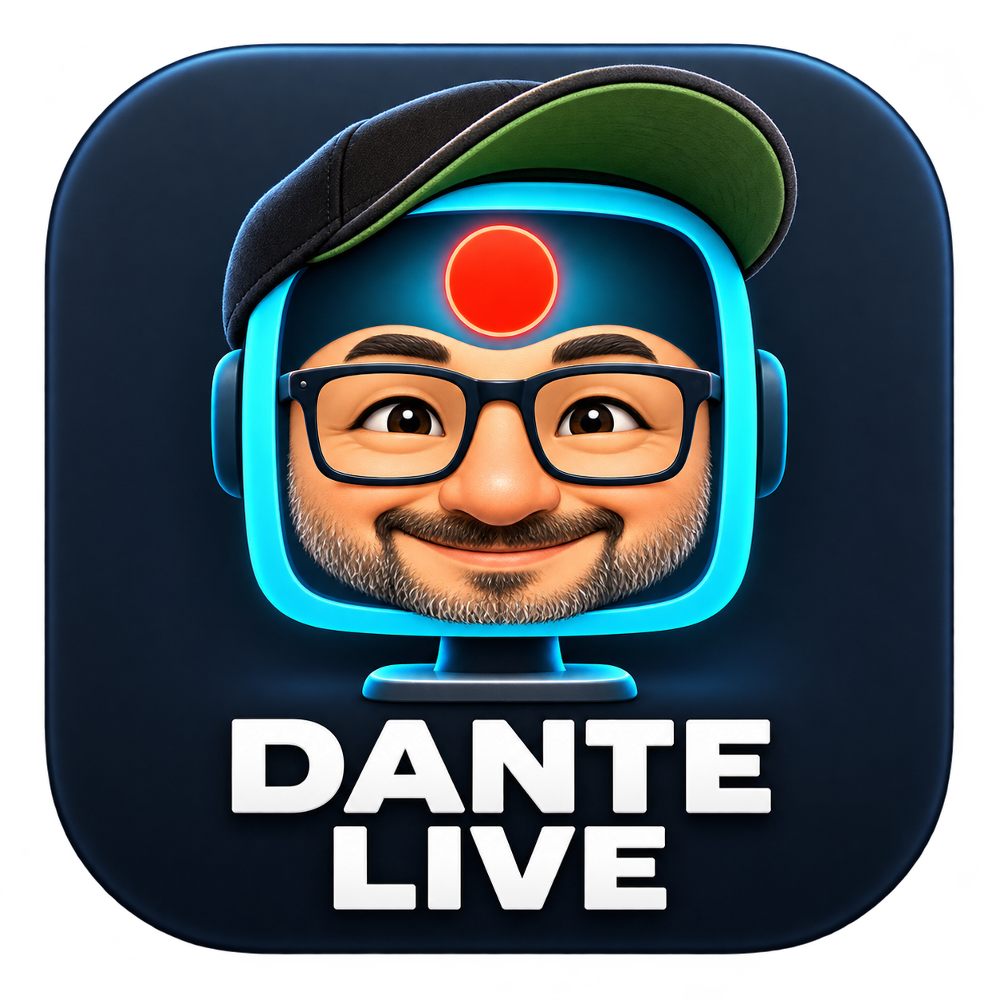

**Um estúdio de produção audiovisual com experiência nativa de Mac.**

Cenas, captura, áudio e transmissão ao vivo — com interface própria em Swift e o motor audiovisual do OBS Studio.

<!-- current-download:start -->
[](https://github.com/dantetesta/dante-live/releases/download/v0.1.30/Dante-Live-0.1.30-macOS-universal.dmg)

**macOS 14+ · Apple Silicon e Intel · Universal 2**
Versão experimental **0.1.30**. Assinado com Developer ID e notarizado pela Apple. [Notas e fontes](https://github.com/dantetesta/dante-live/releases/tag/v0.1.30).
<!-- current-download:end -->

[Começar pelo código](docs/BUILD.md) · [Estado do projeto](docs/STATUS.md) · [Contribuir](CONTRIBUTING.md) · [Propor uma melhoria](https://github.com/dantetesta/dante-live/issues)

</div>

---

## Novidades da 0.1.31

Os cartões de likes e novos inscritos foram redesenhados. Ícone, título, número ou nome e detalhes ocupam áreas próprias; o texto se ajusta à largura e à altura disponíveis, inclusive quando o componente é reduzido no canvas. Os seis presets mantêm cores editáveis e receberam bordas e contrastes mais discretos.

O destaque de comentários e Super Chats agora mostra autor e avatar em uma linha clara, identificação e valor em uma área separada e a mensagem abaixo. O valor se ajusta para aparecer inteiro em cartões compactos. Os estilos foram suavizados, e as miniaturas do seletor mostram o destaque de verdade, não um cartão de chat comum. Mensagens longas continuam paginadas.

## Novidades da 0.1.30

Os campos de tipografia agora oferecem busca entre as famílias de fontes instaladas no Mac, inclusive fontes adicionadas pelo usuário. A mudança vale para faixa de texto, chat e destaque, nome do convidado, likes e inscrições e propriedades genéricas de texto. O projeto preserva a família escolhida; se ela não estiver instalada em outro Mac, o seletor avisa e o texto usa a fonte do sistema.

Likes e inscritos oferecem fontes, tamanhos e estilos independentes para título, contagem/nome e detalhes. Nos comentários, nome e mensagem são independentes; o destaque também separa identificação e valor do Super Chat. Cada trecho tem negrito, itálico e sublinhado. Texto nativo, nome do convidado e faixa animada oferecem os mesmos estilos. Projetos antigos continuam usando a família única salva até que cada trecho seja personalizado.

A faixa de texto ganhou rolagem em ambos os sentidos e um modo **Frases com slide**: cada linha não vazia vira uma frase, exibida no intervalo configurado, entrando por cima ou por baixo. O fundo pode ser uma cor translúcida ou um gradiente de duas cores, com direção, pontos inicial/final e opacidade independente.

## Novidades da 0.1.29

O destaque de comentários e Super Chats pode ser esticado horizontalmente até 3.840 px, acompanhando toda a largura de um canvas 4K. O ajuste reorganiza as linhas do texto, sem esticar a imagem. Nas propriedades do chat e do destaque, **Avatar / ícone** controla de 24 a 144 px o círculo com a inicial da pessoa; nome e mensagem se reposicionam para manter o alinhamento. O tamanho inicial passou a 64 px e pode ser alterado em cada fonte.

## Novidades da 0.1.28

**Áudio de aba do navegador** é uma nova fonte de áudio. Ao adicioná-la, o Dante abre o seletor do Chrome: escolha a aba, marque **Compartilhar áudio** e mantenha a página de captura aberta. Somente o áudio da aba escolhida entra no mixer; o vídeo não é capturado. Após reiniciar o Dante, escolha a aba novamente. A captura antiga **Áudio do Mac → Aplicativo** continua incluindo todas as abas do Chrome.

O menu **Dante Live → Créditos…** abre uma janela com a autoria de Dante Testa, site, comunidade no WhatsApp e dados para doações voluntárias por Pix e PayPal, com botões para copiar.

O topo central do estúdio mostra um carrossel compacto de parceiros, com três banners de 400 × 55 pontos: convite para parcerias, Academy e Napoleon. Cada peça abre seu destino ao clicar; a rotação pausa enquanto o ponteiro está sobre o banner. Em janelas estreitas, o carrossel cede espaço aos controles de transmissão.

[Como usar e limites da captura de aba](docs/BROWSER-TAB-AUDIO.md)

## Novidades da 0.1.27

O componente **Likes e novos inscritos** agora permite definir o tamanho do ícone de like e inscrição separadamente das letras e da Escala geral. O controle vai de 24 a 120 px; em cartões pequenos, o desenho respeita o espaço disponível. Componentes antigos mantêm o tamanho anterior até você escolher outro valor.

## Novidades da 0.1.26

Chat, destaque de comentário e alertas de likes/inscrições ganharam uma **Escala geral** de 50% a 200%. Ela aumenta cartão, ícones e letras juntos, redesenhando a textura na resolução escolhida. Largura e altura continuam independentes para ajustar a área e a quebra de linha. Novos alertas também começam com cartão e tipografia maiores, mais legíveis em cenas 4K; componentes já salvos mantêm seus valores até você alterá-los.

## Novidades da 0.1.25

Ao abrir os estilos do visualizador de áudio, a versão 0.1.24 podia encerrar o aplicativo. A 0.1.25 corrige o desenho da miniatura que causava a falha. Chat, destaque e alertas de likes agora podem ter a largura ajustada pelas alças sem esticar o texto. O painel de conversa permite ocultar um comentário e tirá-lo da fila imediatamente, indicando se chegou a ir ao ar. O componente de likes ganhou seis estilos editáveis e pode mostrar o total aproximado de inscritos do canal e os novos inscritos públicos detectados durante a live.

## Novidades da 0.1.24

O nome do convidado agora é uma camada de cena independente, com seis estilos e atualização durante a chamada sem reconexão. A versão também inclui visualizador de áudio com dez estilos, perfis de produção, MCP local opcional para edição de cenas, reforço de volume e suporte local a três convidados. Os testes e limites de cada recurso estão em [Estado do projeto](docs/STATUS.md). Em uma VPS própria já instalada, a página do convidado precisa ser atualizada para mostrar o botão de mudança de nome.

## Convidados por VPS e preparação RTMP — 0.1.23

- **Participantes → Servidor TURN** conecta uma VPS própria por IPv4 HTTPS. O token fica no Acesso às Chaves; o app aceita importar um perfil privado e testar o serviço. Convites, sinalização e credenciais TURN temporárias passam pela VPS; o vídeo e o áudio usam WebRTC direto ou relay TURN conforme a rede.
- **Preparar live** voltou a aceitar o modo RTMP/RTMPS sem conta YouTube. O título, a descrição e a capa ficam como preparação local; sem API, esses dados precisam ser configurados separadamente na plataforma de destino. Salvar retorna ao estúdio sem iniciar a transmissão.
- A captura de áudio por aplicativo inclui todas as abas; capturar uma janela isola a imagem, não o áudio. A partir da 0.1.28, use a fonte específica de aba para o Chrome.

[Receita de instalação da VPS](server/PROMPT-INSTALACAO.md) · [Limites e testes](docs/GUESTS.md). O ensaio TURN usou dois navegadores no mesmo Mac; convidados reais em redes distintas e lives longas ainda precisam de validação.

## Convidados e enquadramento — 0.1.22

- Se a mídia do convidado cair ou a negociação expirar, o navegador tenta reconectar com o mesmo convite e os dispositivos já autorizados. O botão **Reconectar agora** permanece disponível. Uma sala encerrada ainda exige novo link.
- **Ocultar Dante Live da captura** corrige o controle de exclusão da própria janela na captura de tela. A aplicação visual em uma captura física ainda precisa de confirmação no Mac do operador.
- Option/Alt destaca o recorte em laranja. **Ajustar enquadramento** permite recortar e deslocar o conteúdo de imagens, vídeos e câmeras com uma guia translúcida no editor.

[Convidados e limites de conexão](docs/GUESTS.md) · [Estado de validação](docs/STATUS.md)

## Painéis e organização do chat — 0.1.21

- Painéis flutuantes, móveis pela barra de título, podem coexistir enquanto você opera o estúdio.
- Busca por nome ou mensagem e ordenação por mais recentes/mais antigos.
- Aba **Já exibidos** e tags coloridas. O destaque vai para o histórico 30 segundos após sair do programa; voltar ao ar cancela o prazo.
- Selecionar uma mensagem ou mostrá-la só na prévia não conta como exibição. Histórico limitado à sessão, sem alterar o YouTube.

[Como usar chat e destaques](docs/YOUTUBE-OVERLAYS.md).

## Chat e alertas — 0.1.20

A biblioteca separa **Salvas para transmitir agora** de **Criadas e agendadas**, com atalho **Transmitir** nos cartões. Remova preparações deste Mac ou oculte agendamentos localmente, preservando o canal. O atalho mantém a confirmação e a contagem regressiva.

Cartões de chat redesenhados com seis modelos principais (Clean, Vidro, Neon, Claro, Balões e Terminal) e seis variações. Ajuste nome, texto, distância, cores e opacidade; redimensione largura e altura sem deformar letras. Chat e Super Chat mostram exemplos somente no editor antes da live.

Novo componente **Likes e novos inscritos**: contador do total de likes com animação ao aumentar e fila de inscrições públicas de cinco segundos, sem repetir a pessoa na mesma live. A API é consultada periodicamente: não identifica quem curtiu, não revela inscrições privadas e pode atrasar/limitar resultados. [Como configurar e limites](docs/YOUTUBE-OVERLAYS.md).

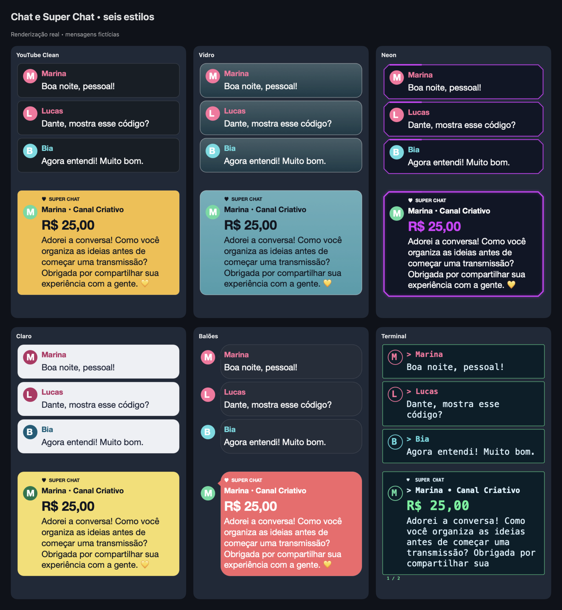

## Conheça o estúdio

Capturas reais da interface **0.1.10**, em um projeto de demonstração. Os textos e os sinais de áudio são exemplos sintéticos; nenhuma transmissão estava em andamento.

**Cenas, canvas e mixer de áudio**

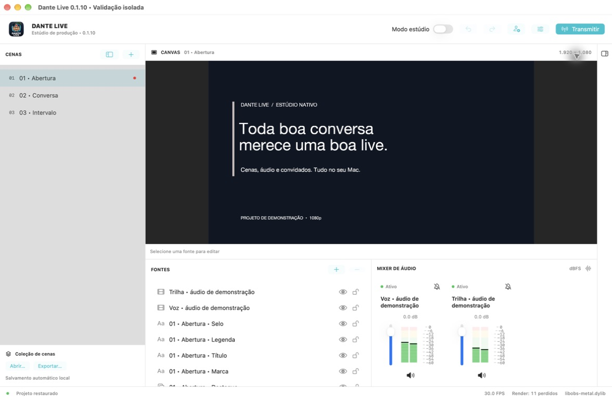

<details>
<summary><strong>Ver mais telas: fontes, modo estúdio, configurações e convidados</strong></summary>

### Fontes por categoria

Cartões com descrição de câmera, tela, microfone, imagens, texto e mídia.

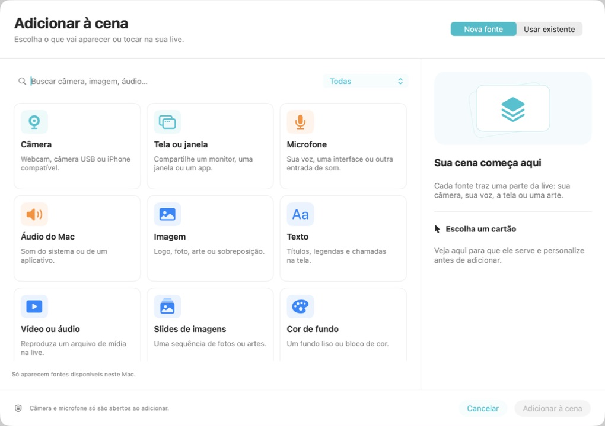

### Prévia e programa

Prepare outra cena antes de fazer o corte ou a transição.

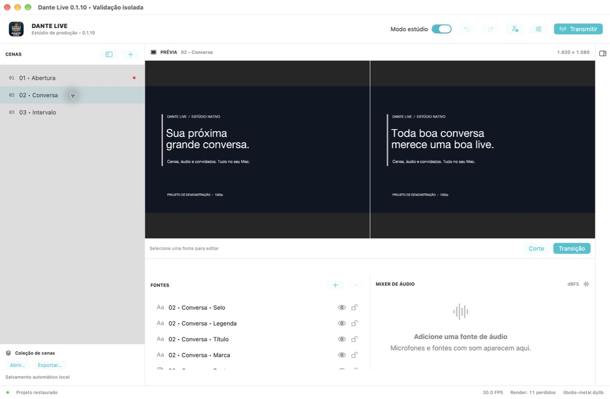

### Configurações organizadas

Qualidade, vídeo e áudio, conexão, YouTube e diagnóstico em abas, com salvamento automático.

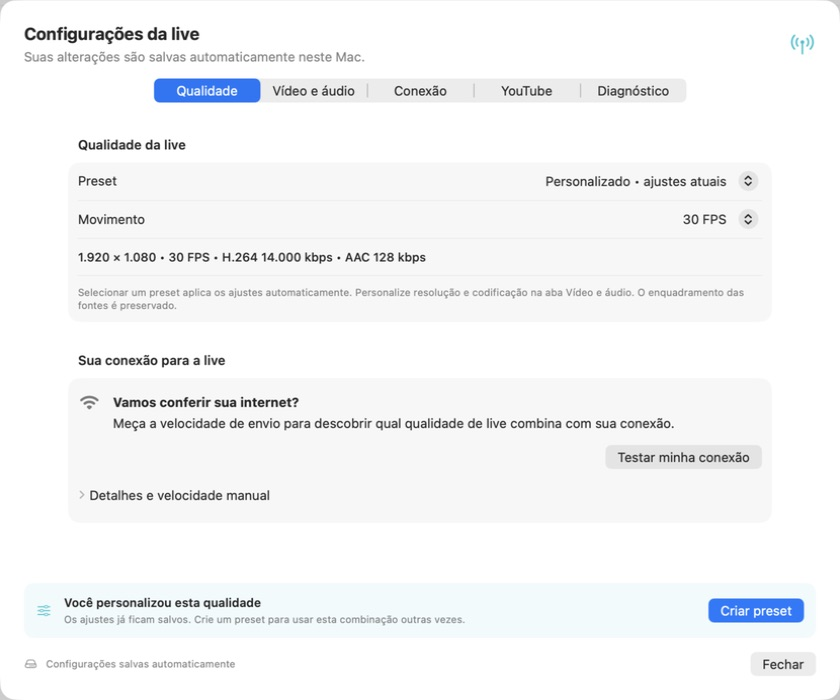

### Convidados por convite

Interface de convite experimental para até dois participantes. A imagem mostra a sala aguardando um convidado; não comprova uma conexão entre redes diferentes. Veja os [limites de rede e TURN](docs/GUESTS.md).

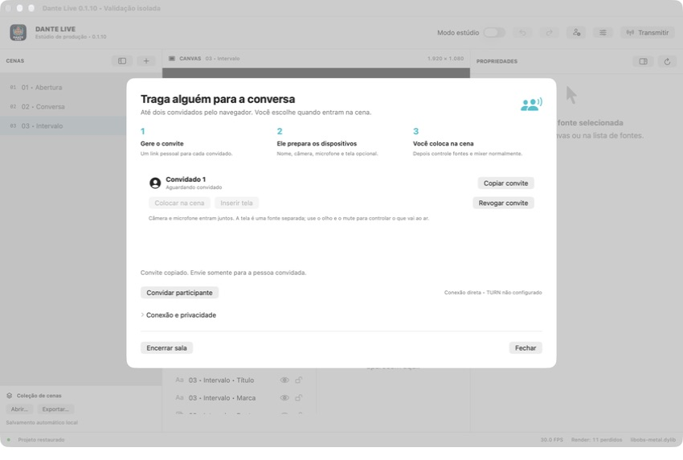

</details>

## Novidades da versão 0.1.19

Adicione uma **faixa de texto animada** para avisos e cupons, com rolagem ou frases em slide, altura, intervalo/velocidade, gradiente, transparência e fonte configuráveis. O **QR Code** cria links, textos e Pix estático, com três estilos e logo opcional. A geração acontece no Mac e verifica a leitura antes de aplicar à cena. O banco confirma o titular da chave Pix; o aplicativo não consulta o cadastro bancário. [Como usar](docs/SCENE-GRAPHICS.md).

## Novidades da versão 0.1.18

- Chat do YouTube como uma fonte na cena, com as últimas mensagens comuns.
- Fila de Super Chats e Super Stickers para revisar, mostrar, ocultar e marcar como exibido. Mensagens pagas só aparecem depois da sua aprovação.
- Destaque animado com 12 estilos, cores e fontes personalizáveis. Textos longos são divididos em páginas.
- Preparação de lives reorganizada, com campos maiores, capa clicável e ações sempre acessíveis.
- Fundo e borda do canvas mais visíveis nos temas claro e escuro.

O chat requer a integração YouTube e uma transmissão iniciada pelo aplicativo. Consulta periódica respeita a cadência da API; não é instantânea e consome quota. Mensagens e fila ficam somente na sessão e são limpas ao encerrar. Validado com API simulada e pixels reais do motor; chat e doações em uma live real ainda precisam de validação. [Detalhes e limites](docs/STATUS.md).

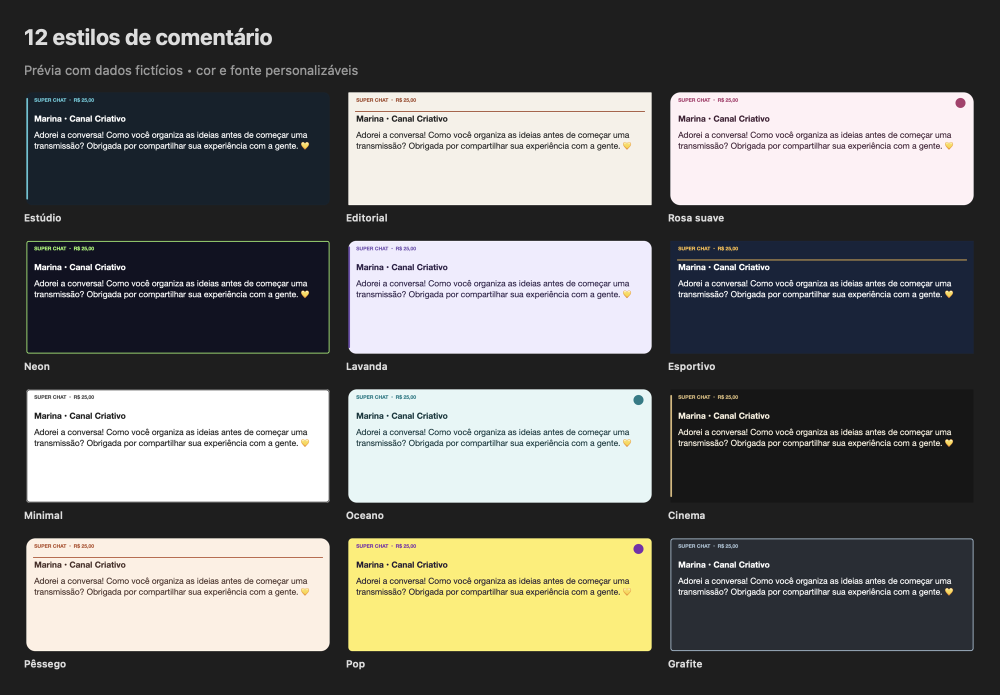

As melhorias anteriores de áudio e latência estão documentadas na [pesquisa de mídia](docs/MEDIA-RESEARCH.md), incluindo o diagnóstico de eco acústico ainda aberto.

## Prepare cada transmissão em seu próprio espaço

Na guia **Preparar live**, organize título, descrição, capa e visibilidade. **Salvar na lista** guarda uma preparação local sem horário marcado; **Agendar…** abre calendário e horário para criar o evento no YouTube. Você pode manter várias preparações por canal, com salvamento automático.

Ao clicar em **Transmitir**, escolha uma preparação salva ou live agendada, confira os dados e confirme. Após a preparação, o envio começa com contagem **3, 2, 1**. O agendamento não inicia a transmissão sozinho. Lives já criadas são editadas no YouTube Studio.

Capturas da interface 0.1.16 em uma preparação de demonstração local, sem conexão ou criação de evento real no YouTube.

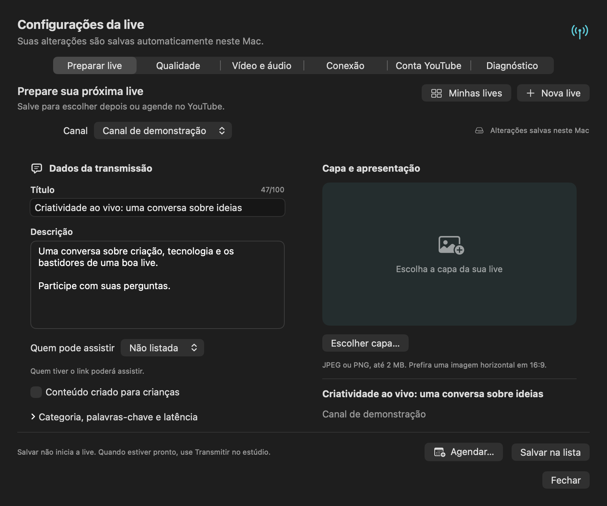

<details>
<summary>Ver o calendário de agendamento</summary>

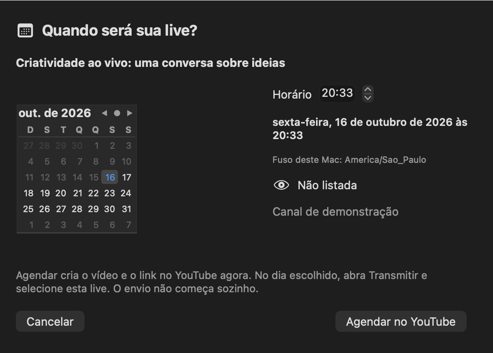

</details>

## Tutorial: integrar com o YouTube

[**▶ Assistir ao tutorial de Dante Testa — 5 min 54 s**](https://youtu.be/WHGy0IJvG5Y)

Acompanhe os cliques para criar o projeto no Google Console, ativar a API e baixar o JSON de conexão. O vídeo usa o Dante Studio como exemplo; o [manual HTML do Dante Live](https://github.com/dantetesta/dante-live/raw/refs/heads/main/Sources/Help/youtube-integration.html) adapta as etapas para este aplicativo. Baixe o HTML e abra no navegador; ele também pode ser consultado offline.

| Etapa | Ir ao trecho |
|---|---|
| Criar e selecionar o projeto | [00:25](https://youtu.be/WHGy0IJvG5Y?t=25) |
| Ativar YouTube Data API v3 | [01:33](https://youtu.be/WHGy0IJvG5Y?t=93) |
| Configurar a tela de permissão OAuth | [02:06](https://youtu.be/WHGy0IJvG5Y?t=126) |
| Adicionar usuários de teste | [03:18](https://youtu.be/WHGy0IJvG5Y?t=198) |
| Selecionar escopos | [04:05](https://youtu.be/WHGy0IJvG5Y?t=245) |
| Criar cliente para computador e baixar JSON | [05:02](https://youtu.be/WHGy0IJvG5Y?t=302) |

**Atenção à permissão:** o Dante Live solicita `https://www.googleapis.com/auth/youtube` para gerenciar lives e agendamentos. Na etapa dos escopos, siga o manual do Live: `youtube.upload` e `youtube.readonly`, mostrados para o Studio, não substituem essa permissão. O vídeo termina no download do JSON; o manual continua com importação e conexão no Dante Live. [Permissões aceitas para criar lives](https://developers.google.com/youtube/data/live/reference/rest/v3/liveBroadcasts/insert).

A versão **0.1.11** inclui **Manual de integração com YouTube** ao lado da importação do JSON, com o guia disponível offline e atalhos para o vídeo. [Guia da integração](docs/YOUTUBE.md).

## Claro, escuro ou automático

Em **Dante Live → Preferências… → Aparência** (⌘,), escolha **Claro**, **Escuro** ou **Automático**. A escolha fica salva neste Mac; Automático acompanha a aparência do macOS. Essas opções já existem no aplicativo.

Capturas reais do código atual, em uma cópia isolada com projeto de demonstração e áudio sintético, sem transmissão. As telas de aparência também estão disponíveis na 0.1.10.

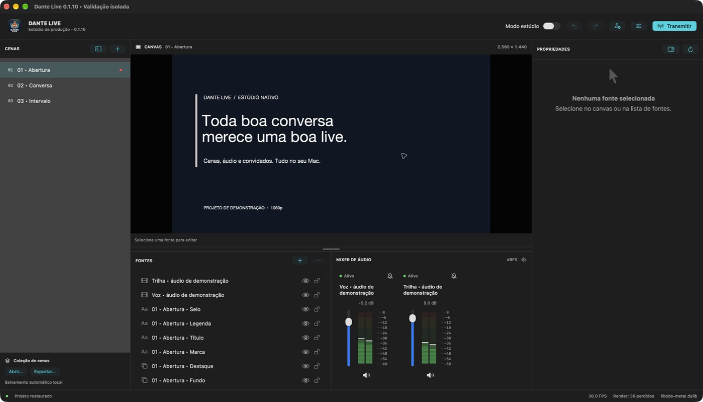

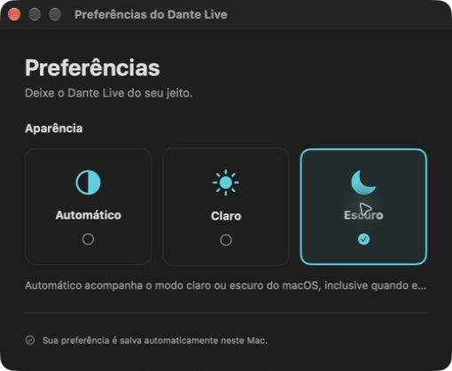


## Por que estamos construindo o Dante Live

Produzir uma live exige cuidar de muitas coisas ao mesmo tempo: enquadramento, cenas, áudio, arquivos, convidados e conexão. Queremos tornar esse trabalho mais claro e confortável para quem usa Mac, com uma interface organizada e controles que respeitem o jeito de trabalhar do sistema.

O Dante Live combina **SwiftUI e AppKit** na interface com **libobs e componentes audiovisuais do OBS Studio** no motor. Reaproveitamos o que já resolve captura, composição e codificação, enquanto construímos uma experiência própria e evoluímos os componentes com base em testes e medições.

O projeto é aberto a quem queira escrever código, testar equipamentos, melhorar a experiência, documentar ou ajudar a definir o que torna um estúdio realmente útil no dia a dia.

## Plataforma

O código atual é exclusivo para **macOS 14.0 Sonoma ou superior**:

- **Apple Silicon:** arm64, a partir do M1, nos Macs compatíveis com o sistema.
- **Intel:** x86_64, nos Macs oficialmente compatíveis com macOS 14 ou posterior.
- Build Universal 2 para o aplicativo e dependências essenciais.

Não há versões para Windows, Linux, iPhone ou iPad. A interface principal não usa Qt, Electron ou Tauri.

O deployment target 14.0 e as slices Universal 2 foram inspecionados; testes em **Intel físico e macOS 14 real ainda estão pendentes**. O backend Metal upstream é experimental e exclusivo Apple Silicon; Intel utiliza OpenGL na implementação atual.

## O que já existe

A versão **0.1.11** amplia a base funcional, em estágio experimental, com funcionalidades reais:

- Distribuição oficial assinada com Developer ID e notarizada pela Apple a partir da 0.1.8.
- Atualizações pelo menu do Mac, aviso ao abrir, changelog e instalação/reinício com proteção durante a live.
- Ocultar e restaurar lives da lista somente neste Mac, por canal, sem alterar o YouTube.
- Biblioteca visual de lives do YouTube com capa, título, visibilidade e horário local; seleção pelo botão Transmitir antes da confirmação.
- Adição de fontes em cartões ilustrados, com descrições simples, busca, categorias e opção separada para reutilizar uma fonte existente.
- Cenas e fontes com criação, duplicação, renomeação, ordenação por arrasto, visibilidade e bloqueio.
- Propriedades de fontes aplicadas automaticamente: seleções imediatas e campos digitados com pausa de 300 ms.
- Menu de contexto com propriedades em modal, filtros, renomear, ocultar, bloquear, transformar, ordenar e remover.
- Preview, seleção de elementos, arrasto, redimensionamento proporcional, crop, rotação, ajuste ao canvas e centralização.
- Integração de tela, janela, câmera, microfone, mídia, imagem, cor e texto por módulos selecionados da libobs; a validação varia por fonte e dispositivo.
- Painel de câmera com dispositivos, presets, formato/FPS e prévia da fonte.
- Mixer vertical estéreo com escala em dB, nível médio, pico e retenção de pico; volume, mute e filtros reais.
- ⌘F para ajustar ao canvas, Option/Alt nas alças para recortar e dentro da fonte para reenquadrar.
- Máscaras de câmera com formatos, cantos arredondados, zoom e enquadramento.
- Divisória visível e arrastável entre canvas e painéis, com proporção salva, teclado e VoiceOver.
- Preferências de aparência: automática pelo Mac, clara ou escura.
- Convites temporários para até dois convidados no navegador, com câmera, microfone, tela e retorno de áudio sem a própria voz.
- Modo estúdio, corte/fade e transmissão manual RTMP/RTMPS, com início pelo estúdio e contagem regressiva cancelável.
- Configurações em abas, autosave, presets automáticos e criação contextual de presets personalizados.
- Diagnóstico de internet legível, canais RTMP nomeados e painéis laterais recolhíveis.
- RTMP/RTMPS manual com título, descrição e capa salvos como referência local; o envio usa servidor e chave, enquanto os dados públicos da live são configurados no serviço de destino.
- Integração YouTube com OAuth, rascunhos de título/descrição/capa, agendamento e escolha do mesmo vídeo para transmitir (exige configuração Google; validação real pendente).
- Alerta visual de microfone sem sinal por 30 segundos durante a live, com recuperação automática e controle por fonte.
- Presets de **1080p, 1440p/QHD e 2160p/4K**, com 30/60 FPS e configuração de bitrate orientada pelo upload.
- Projeto JSON com salvamento atômico, cópia anterior e recuperação; conexão RTMP persistente, chave opcional no Keychain.

O produto é focado em lives: gravação de arquivos e replay buffer foram retirados da aplicação. A captura de tela continua disponível como fonte para transmissão.

O envio ao YouTube pela conexão manual foi testado pelo mantenedor. A integração OAuth/API da versão 0.1.6 foi validada com testes offline: login e agendamento reais ainda precisam ser conferidos em uma conta autorizada. Veja [como configurar o YouTube](docs/YOUTUBE.md).

**Há limitações conhecidas:** há relato de lag no preview/modo estúdio; o editor avançado e a cobertura de dispositivos estão incompletos. Consulte o [estado detalhado](docs/STATUS.md).

## Para onde queremos levar o projeto

### Produção mais simples

Evoluir grupos, seleção múltipla, alinhamento e atalhos. Painéis recolhíveis, ordenação por arrasto, propriedades em modal e canais nomeados já estão implementados; precisamos ampliar a validação de uso.

### Convidados por link

Disponível de forma **experimental na 0.1.9**: clique no ícone de convidar, gere um link e envie à pessoa. Ela informa o nome, autoriza câmera/microfone e pode compartilhar uma tela. O apresentador insere câmera, microfone e tela como fontes independentes, com mute, volume e visibilidade.

A mídia usa WebRTC. Por padrão, o link HTTPS usa Cloudflare Quick Tunnel (temporário e sem garantia); em **Participantes → Servidor TURN**, é possível configurar uma VPS própria por IPv4 com HTTPS, página de convite estável e TURN. O token fica no Acesso às Chaves e o app não solicita SSH. A conexão direta usa STUN e, quando necessário, tenta o TURN configurado. Ainda é preciso validar convidados em redes externas distintas e sessões longas. [Guia de convidados e limites](docs/GUESTS.md).

### Desempenho demonstrável

Medir CPU, GPU, memória, tempo por quadro, perdas e sincronização; reduzir cópias e trabalho redundante quando houver evidência de benefício. Não tratamos a troca de linguagem como ganho automático, nem redução de qualidade como otimização equivalente.

### Cobertura audiovisual

Avançar na equivalência funcional com os recursos macOS do OBS, incluindo editor, filtros, saídas, browser, câmera virtual e integrações auditadas individualmente. A prioridade atual é a transmissão pelo YouTube, com RTMP manual e integração de agendamento por API. Outras redes e transmissão simultânea ficam para etapas posteriores.

## Como colaborar

Procuramos contribuições em **Swift/SwiftUI/AppKit, C/C++/Objective-C++, Metal, áudio, vídeo, WebRTC, testes, acessibilidade e documentação**. Também precisamos de quem teste em Macs Intel e Apple Silicon, com diferentes câmeras, microfones e capturadoras.

Uma contribuição útil pode ser pequena: reproduzir um bug, tornar uma mensagem compreensível, corrigir um controle por teclado ou medir um cenário de produção. Abra uma [issue](https://github.com/dantetesta/dante-live/issues) com o problema e o comportamento esperado; para código, siga o [guia de contribuição](CONTRIBUTING.md) e envie um pull request.

## Compilar

O build requer um Mac, ferramentas Apple, Python 3, Git, Go (toolchain 1.27.2 para o helper de convidados) e o runtime oficial **OBS Studio 32.2.2**. Ainda há dependência de binários OBS pré-compilados; não é uma reconstrução integral de todas as bibliotecas a partir das fontes.

```sh
git clone https://github.com/dantetesta/dante-live.git
cd dante-live
env DANTE_BUILD_DIR=build/dev bash scripts/build.sh
```

Leia [BUILD.md](docs/BUILD.md) para configurar a origem do OBS, rodar os testes e entender os limites do empacotamento. O build é separado da instalação e dos perfis do OBS. Não substitua uma instalação usada em produção para testar o projeto.

## Organização do código

| Diretório | Responsabilidade |
|---|---|
| `Sources/App` | Interface nativa, modelo de projeto, propriedades, presets e persistência |
| `Sources/Bridge` | Contrato C e integração Objective-C++ com libobs |
| `Tests` | Verificações de motor, persistência, editor e ciclo de vida |
| `scripts` | Aquisição das referências, build, testes e pacote local |
| `packaging` | Dependências fixadas, patches, auditoria e assinatura local |
| `docs` | Arquitetura, build, estado e licenças |
| `updates` | Catálogo assinado e histórico de changelogs; DMGs nas Releases |

Mais detalhes em [ARCHITECTURE.md](docs/ARCHITECTURE.md).

## Estado de distribuição

O botão no topo baixa o **DMG experimental corrente**. Abra o DMG, arraste Dante Live para Aplicativos e execute-o quando os dispositivos estiverem disponíveis. A distribuição oficial 0.1.8+ usa Developer ID e notarização Apple. Confira a origem oficial; não desative as proteções do macOS.

As [Releases](https://github.com/dantetesta/dante-live/releases) incluem o instalador, fontes correspondentes com dependências fixadas e SHA-256. A partir da 0.1.8, o aplicativo e o DMG oficiais são **assinados com Developer ID e notarizados pela Apple**. Builds locais sem credenciais continuam ad hoc. Testes prolongados e compatibilidade física Intel/macOS 14 permanecem pendentes. Os builds não substituem o OBS instalado.

A partir da 0.1.7, use **Dante Live → Verificar atualizações…** para as próximas versões. O aplicativo avisa ao abrir, mostra as novidades e instala após sua confirmação, preservando o projeto. Quem usa 0.1.6 ou anterior precisa instalar a versão corrente uma vez pelo DMG. [Como funcionam as atualizações](docs/UPDATES.md).

Para mantenedores: `scripts/release.sh` compila, testa, empacota e publica uma versão experimental com fontes e checksums; o botão é atualizado para a versão publicada. Veja [RELEASING.md](docs/RELEASING.md).

## Licença e créditos

Dante Live é disponibilizado sob a **GNU General Public License, versão 2 ou posterior**. Consulte [LICENSE](LICENSE) e [DEPENDENCIES.md](docs/DEPENDENCIES.md).

O projeto utiliza o trabalho do [OBS Project e seus colaboradores](https://github.com/obsproject/obs-studio), além das bibliotecas de terceiros identificadas no inventário. A referência atual é **OBS Studio 32.2.2**, commit `ba2f32bdf791005443988a4955e963663e16b1ed`.

Dante Live é um projeto independente; não é uma versão oficial nem possui afiliação anunciada com o OBS Project. A interface e a identidade visual são próprias.

Forks não recebem nossas credenciais. Para notarizar e distribuir uma versão própria, cada mantenedor usa sua conta Apple, identidade e chaves de atualização. Veja [assinatura, notarização e forks](docs/NOTARIZATION.md).
