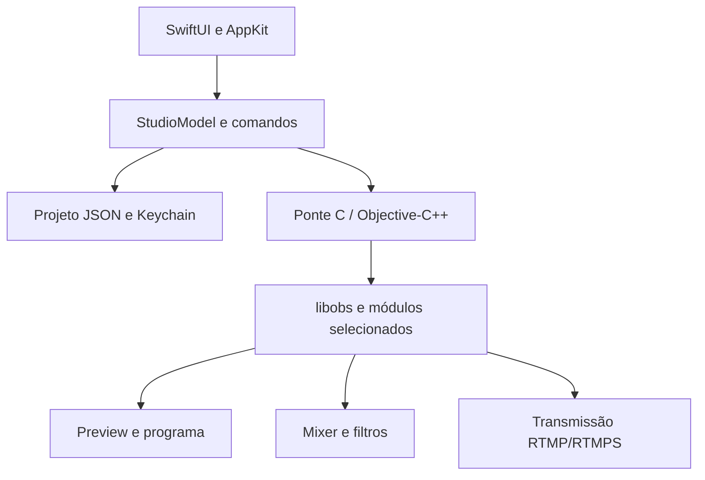

# Arquitetura

O Dante Live separa a interface desktop, o modelo de projeto e o motor audiovisual. A interface principal é nativa; não usa Qt, Electron ou Tauri.

## Interface e estado

`Sources/App/` contém a janela, painéis, editor visual, propriedades, mixer, captura, presets e persistência. `StudioModel` coordena comandos e publica o estado real recebido do motor. As ações de início/fim de saída distinguem solicitação, ativação e falha assíncrona.

## Contrato do motor

`Sources/Bridge/DanteEngine.h` descreve a API. O contexto é opaco; strings retornadas são emprestadas e precisam ser copiadas imediatamente. Chamadas da aplicação são serializadas na thread principal. Callbacks internos não manipulam SwiftUI. Displays devem ser destruídos antes do motor, e referências libobs precisam ter aquisição/liberação balanceadas.

A referência é OBS Studio 32.2.2, commit `ba2f32bdf791005443988a4955e963663e16b1ed`. O reaproveitamento mantém composição, fontes, áudio, filtros e encoders, sem incorporar a interface Qt.

## Renderização e capacidades

No código atual, Apple Silicon tenta o backend Metal experimental do OBS e pode usar OpenGL como fallback. Intel usa OpenGL: o backend Metal upstream desta referência não suporta Intel. Uma superfície Metal para Intel continua pendente.

Encoders e fontes são enumerados em execução. Disponibilidade de encoder de hardware e confirmação de uso de hardware pela sessão são estados diferentes. Não há promessa de desempenho idêntico entre GPUs ou arquiteturas.

## Persistência e saídas

O projeto é salvo em JSON versionado com substituição atômica, cópia anterior e recuperação. Os dados são independentes dos perfis do OBS. Credenciais inline em propriedades não são aceitas. A chave RTMP pode ser armazenada no Keychain, mas o cadastro de conexões e a restauração automática do servidor ainda estão incompletos.

O produto transmite H.264/AAC por RTMP/RTMPS manual. Gravação de arquivos e replay foram retirados da aplicação; comandos desses recursos são recusados pelo modelo. O patch em `packaging/patches/` corrige o ciclo de conexão/parada RTMP da referência. Apenas o serviço RTMP manual é incluído, sem o atualizador automático de catálogo.

## Próxima integração: convidados

O fluxo solicitado prevê convite temporário, escolha de nome/câmera/microfone/tela no navegador e fontes separadas no editor. A conexão deve tentar o caminho direto e usar TURN quando necessário. Retorno de áudio sem a própria voz, reconexão, autenticação do convite e consumo de infraestrutura fazem parte da aceitação.

Essa integração ainda não está disponível neste snapshot. WebRTC não muda a interface principal do Dante para uma página web: o navegador é o cliente do convidado.

## Configuração e segurança da live

LiveSettingsModel mantém as preferências e presets nomeados em documento JSON com escrita atômica e validação. Segredos usam LiveKeyVault/Keychain; não fazem parte dos presets ou do JSON. Arquivo ilegível não é sobrescrito. Edições de vídeo durante uma transmissão só são aplicadas na próxima saída. LiveCountdown controla início cancelável 3–2–1; o estado Ao vivo vem do motor, não do término da contagem.

MicrophoneSilenceWatch recebe amostras de fontes elegíveis e timestamps monotônicos de sinal. O callback libobs só atualiza valores atômicos; a interface verifica a janela de 30 segundos e mostra aviso local até a recuperação. Silêncio digital após filtros também pode gerar aviso; não se afirma diagnóstico físico da bateria.
